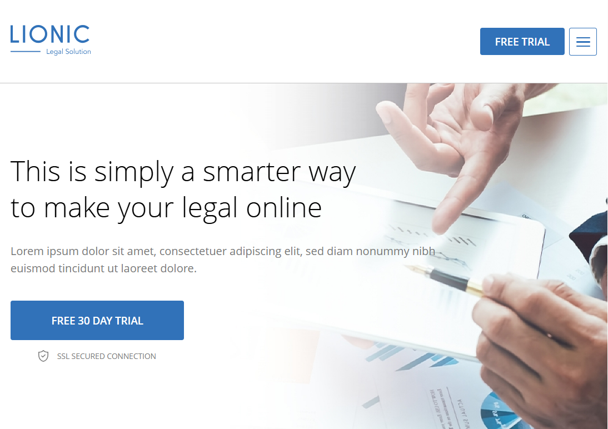

# Lionic

Адаптивный одностраничный сайт юридического сервиса. Учебный frontend-проект для портфолио, созданный на HTML, CSS и JavaScript.



**Демо:** (https://aden1109.github.io/lionic/)
## О проекте

Сайт знакомит с услугами Lionic и содержит разделы со статьями, отзывами клиентов, контактной информацией и формой обратной связи.

## Возможности

- Адаптивная вёрстка для мобильных устройств и компьютеров.
- Навигация по разделам страницы.
- Мобильное меню с закрытием по Escape и нажатию вне меню.
- Форма с проверкой обязательных полей и фильтрацией символов в поле телефона.

## Технологии

- HTML5
- CSS3: Flexbox и media queries
- JavaScript
- Normalize.css и Bootstrap Grid

## Особенности реализации

- Семантическая HTML5-разметка: `header`, `main`, `nav`, `section`, `article` и `footer`.
- Имена CSS-классов описательные, в стиле «блок-элемент»; для состояний используются модификаторы вроде `--open`. Строгая методология БЭМ не применяется.
- Адаптивная вёрстка построена по принципу Desktop First: стили для меньших экранов задаются через media queries с `max-width`.

## Чему научился

- Управлять мобильным меню через события JavaScript: закрывать по Escape, клику вне меню и выбору пункта.
- Фильтровать недопустимые символы при вводе номера телефона.
- Учитывать поведение браузера при восстановлении позиции прокрутки после перезагрузки страницы.

## Структура проекта

```text
.
├── index.html
├── css/
│   ├── bootstrap-grid.min.css
│   ├── media.css
│   ├── normalize.css
│   └── style.css
├── fonts/
├── images/
└── script/
    └── script.js
```

## Примечание

Форма предназначена для демонстрации интерфейса: данные не отправляются и не сохраняются.


